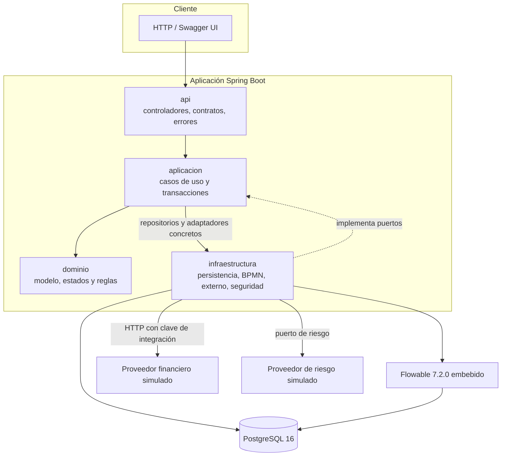
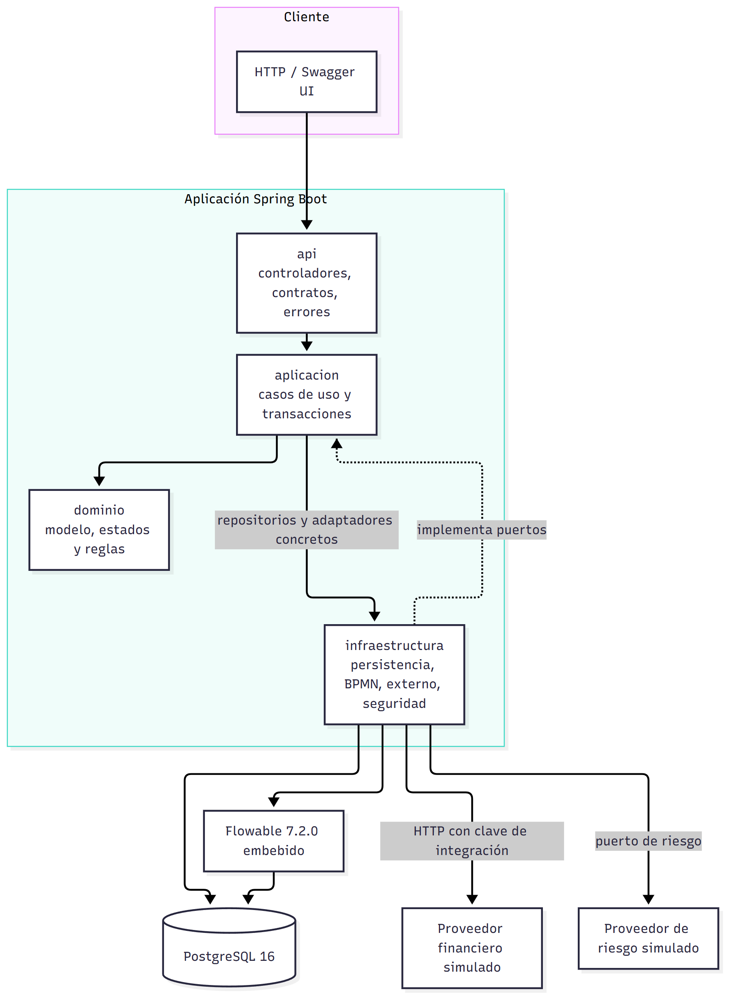
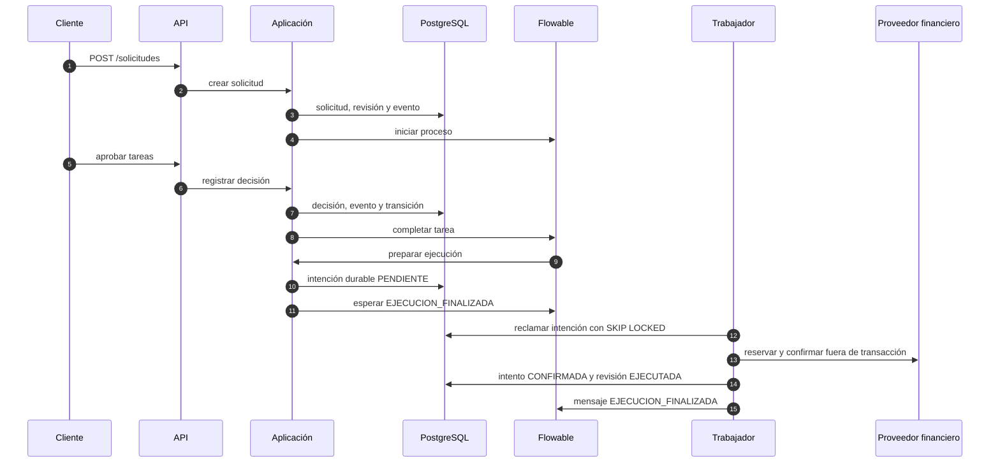
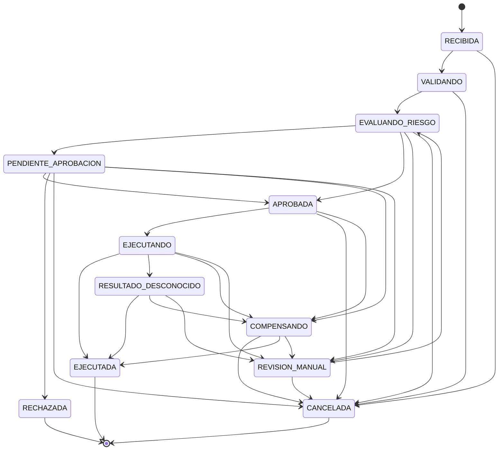

# Arquitectura

Este documento describe la arquitectura implementada: las capas reales, sus
dependencias, la frontera transaccional, los componentes externos y el recorrido
de una solicitud. Cada afirmación se puede contrastar con el código enlazado.

## 1. Resumen

El sistema es un monolito modular Spring Boot con cuatro capas y dos
integraciones simuladas. Flowable corre embebido y comparte la transacción con
JPA. La ejecución financiera y la compensación se resuelven con intenciones
durables y trabajadores que llaman a los proveedores fuera de transacción.

La versión vectorial está en [`arquitectura.svg`](arquitectura.svg). El diagrama
y este texto describen el mismo código: si cambia una dependencia, cambian los
dos.

## 2. Capas y dependencias reales

| Desde | Hacia | Qué muestra |
|---|---|---|
| `api` | `aplicacion` | Los controladores llaman a los servicios de casos de uso. |
| `api` | `dominio` | Los contratos usan enumeraciones, excepciones y reglas de validación. |
| `api` | `infraestructura.seguridad` | `FiltroFirmaRiesgoExterno` usa `FirmaRiesgoExterno`. |
| `aplicacion` | `dominio` | Reglas, estados y entidades. |
| `aplicacion` | `infraestructura.persistencia` | 33 clases de `aplicacion` usan repositorios Spring Data. Es una concesión. |
| `aplicacion` | `infraestructura.seguridad` | Firma HMAC del riesgo y propiedades del JWT. |
| `aplicacion` | `infraestructura.ejecucion` | `ServicioReintentoIncidente` usa `TrabajadorRecuperacionEjecucion`. Es una concesión. |
| `infraestructura` | `aplicacion` | Los adaptadores implementan los puertos de la aplicación. |
| `infraestructura` | `dominio` | Los adaptadores mapean entidades y estados. |
| `dominio` | — | No importa ninguna otra capa. |

Las dos dependencias marcadas como concesión son las que impiden llamar a esto
una arquitectura hexagonal pura. Se documentan en
[ADR-001](decisiones/adr-001-arquitectura-en-capas.md).

## 3. Concesión JPA

Las entidades viven en `dominio.modelo` con anotaciones JPA y los repositorios
Spring Data en `infraestructura.persistencia`. La capa de aplicación los consume
de forma directa.

- **Ventaja:** un solo modelo, sin mapeadores ni conversiones.
- **Costo:** el dominio depende de `jakarta.persistence` y la aplicación depende
  de Spring Data.
- **Límite:** el dominio sigue sin depender de HTTP, de Flowable ni de la API.

La separación no está verificada por ArchUnit: la dependencia está declarada en
`pom.xml`, pero no hay reglas activas.

## 4. Frontera transaccional

La regla es simple: **ninguna llamada HTTP ocurre dentro de una transacción**.

### Dentro de la transacción

- La decisión de aprobación, el evento, la tarea de negocio y el avance de
  Flowable (`ServicioDecisionAprobacion`, `ServicioTransicionRevision`).
- La preparación de la intención de ejecución y la transición a `EJECUTANDO`
  (`ServicioIntencionEjecucion.preparar`).
- El registro del resultado confirmado y el mensaje al proceso
  (`ServicioIntencionEjecucion.registrarConfirmacion`).
- La recepción del evento de riesgo y su persistencia antes de aplicar nada
  (`ServicioEventoExterno.registrar`).
- La preparación de la cancelación y de la compensación
  (`ServicioIntencionCancelacion`, `ServicioIntencionCompensacion`).

### Fuera de la transacción

- La reserva y la confirmación contra el proveedor financiero
  (`TrabajadorEjecucion`).
- La consulta y la liberación de una reserva (`ServicioCompensacion`).
- El envío de la evaluación de riesgo (`TrabajadorRiesgoExterno`).
- El adaptador HTTP (`AdaptadorProveedorFinancieroHttp`) y el simulador de riesgo
  (`ProveedorRiesgoSimulado`).

El patrón se repite: el trabajador reclama en una transacción corta, llama afuera,
y registra el resultado en otra transacción corta. Así un reinicio no pierde la
intención y una respuesta lenta no bloquea filas.

## 5. Monolito modular

Se eligió un solo despliegue porque las etapas del flujo comparten estado y
necesitan consistencia fuerte. La transacción compartida entre JPA y Flowable es
posible precisamente porque todo corre en el mismo proceso y con el mismo
`DataSource`.

Los microservicios habrían exigido consistencia eventual, un bus y compensaciones
entre servicios. El proveedor financiero es HTTP y no participa de 2PC, así que
una transacción distribuida tampoco habría resuelto la idempotencia del efecto.

La decisión completa está en [ADR-002](decisiones/adr-002-monolito-modular.md) y
[ADR-003](decisiones/adr-003-flowable-transaccion-compartida.md).

## 6. Componentes externos

| Componente | Rol | Cómo se integra |
|---|---|---|
| PostgreSQL 16 | Estado de negocio, inbox, intenciones y tablas de Flowable. | Spring Data JPA, Flyway y el `DataSource` compartido. |
| Flowable 7.2.0 | Proceso `aprobacionFinanciera`. | Embebido, mismo gestor de transacciones, tablas `act_*`. |
| Proveedor financiero simulado | Reserva, confirma, consulta y libera operaciones. | HTTP con `X-Clave-Integracion`; estado en `operacion_simulada`. |
| Proveedor de riesgo simulado | Responde con un evento firmado. | Puerto `PuertoProveedorRiesgo` y endpoint de notificación con HMAC. |

Los contratos de los simuladores están en
[`docs/integraciones/proveedor-financiero-simulado.md`](integraciones/proveedor-financiero-simulado.md)
y [`docs/integraciones/riesgo-externo-simulado.md`](integraciones/riesgo-externo-simulado.md).

## 7. Flujo principal

1. **Crear:** la API valida la solicitud, la persiste con su revisión y registra
   `SOLICITUD_CREADA`.
2. **Clasificar:** se calcula el riesgo interno y el plan de aprobación.
3. **Iniciar:** se crea la instancia del proceso con el plan ya calculado.
4. **Aprobar:** cada tarea humana registra la decisión, el evento y completa la
   tarea del motor en la misma transacción. El rechazo cancela las demás tareas.
5. **Preparar la ejecución:** el delegate persiste la intención durable y deja la
   revisión en `EJECUTANDO`; el proceso espera `EJECUCION_FINALIZADA`.
6. **Ejecutar:** el trabajador reclama la intención, reserva y confirma fuera de
   transacción y registra el resultado.
7. **Cerrar:** el mensaje al proceso lo lleva a `finProceso` o a
   `finResultadoDesconocido`. Si el resultado es incierto, queda un incidente.

La cancelación sigue un camino aparte: la aplicación prepara la intención de
compensación, libera la reserva fuera de transacción y recién entonces envía
`CANCELACION_SOLICITADA` al subproceso del motor.

## 8. Máquina de estados de la revisión

La tabla de transiciones vive en
[`EstadoRevision`](../src/main/java/com/workflow/financiero/dominio/estado/EstadoRevision.java).
`RevisionSolicitud.cambiarEstado` la aplica y `ServicioTransicionRevision`
registra el evento en la misma transacción.

Estados terminales: `RECHAZADA`, `CANCELADA` y `EJECUTADA`. El proceso completo
del motor, con tareas, compuertas y temporizadores, está en
[`docs/bpmn/README.md`](bpmn/README.md).

## 9. Mapa de paquetes

| Paquete | Contenido | Ejemplos |
|---|---|---|
| `api.controlador` | Endpoints REST. | `ControladorSolicitudFinanciera`, `ControladorTareaAprobacion` |
| `api.contrato` | Peticiones, respuestas y errores. | `CrearSolicitudPeticion`, `ErrorApiRespuesta` |
| `api.error` | Manejo uniforme de errores y correlación. | `ManejadorErroresApi`, `FiltroCorrelacion` |
| `aplicacion.servicio` | Casos de uso y transacciones. | `ServicioRegistroSolicitud`, `ServicioDecisionAprobacion` |
| `aplicacion.puerto` | Contratos salientes. | `PuertoProceso`, `PuertoProveedorFinanciero` |
| `aplicacion.configuracion` | Propiedades por ambiente. | `PropiedadesEjecucion`, `PropiedadesAprobacion` |
| `aplicacion.simulador` | Proveedor financiero de demostración. | `ServicioSimuladorProveedorFinanciero` |
| `dominio.modelo` | Entidades y catálogos. | `SolicitudFinanciera`, `RevisionSolicitud`, `IntentoEjecucion` |
| `dominio.estado` | Estados y niveles. | `EstadoRevision`, `NivelRiesgo` |
| `dominio.regla` | Políticas, validaciones y riesgo. | `PoliticaAprobacionPorMonto`, `ValidadorSolicitudCompuesto` |
| `dominio.evento` | Eventos de auditoría. | `EventoSolicitud`, `TipoEventoSolicitud` |
| `dominio.ejecucion` | Contrato de operaciones financieras. | `OperacionFinanciera`, `HuellaOperacionFinanciera` |
| `infraestructura.persistencia` | Repositorios Spring Data. | `IntentoEjecucionRepositorio` |
| `infraestructura.bpmn` | Adaptador y delegates de Flowable. | `AdaptadorProcesoFlowable`, `DelegadoPrepararEjecucion` |
| `infraestructura.ejecucion` | Trabajadores y planificador. | `TrabajadorEjecucion`, `TrabajadorCompensacion` |
| `infraestructura.externo` | Adaptadores HTTP y simulador de riesgo. | `AdaptadorProveedorFinancieroHttp`, `ProveedorRiesgoSimulado` |
| `infraestructura.seguridad` | JWT, BCrypt y usuarios demo. | `ConfiguracionSeguridad`, `SembradorUsuariosDemo` |
| `infraestructura.simulador` | Estado persistido del proveedor. | `OperacionSimulada` |

## 10. Patrones de integración

Estos mecanismos no son patrones de diseño del enunciado, pero explican cómo el
sistema evita efectos duplicados y pérdidas de estado.

### Intención durable antes del despacho

`intento_ejecucion`, `intento_compensacion` y `evaluacion_riesgo` se persisten
antes de llamar al proveedor. Si el proceso se cae, el trabajador retoma desde el
estado guardado.

### Inbox de eventos

`evento_externo` guarda el evento antes de aplicarlo. La unicidad
`(proveedor, identificador_evento)` y la huella del cuerpo distinguen un
duplicado idéntico de un conflicto de contenido. Un evento temprano queda
pendiente hasta que el proceso lo espera.

### Receptor idempotente

La misma clave y la misma huella devuelven el mismo resultado sin repetir el
efecto. Una clave igual con huella distinta responde `409`. La identidad
financiera es la clave estable de la intención, no un identificador de la API.

### Reclamación con `FOR UPDATE SKIP LOCKED`

Los repositorios de intención de ejecución, compensación y eventos externos
reclaman la fila más antigua sin bloquear a los demás trabajadores. Es lo que
permite reiniciar sin duplicar y, a futuro, correr más de un nodo.

## 11. Documentos relacionados

- [Patrones de diseño](patrones.md)
- [Decisiones de arquitectura](decisiones/README.md)
- [Limitaciones](limitaciones.md)
- [Tecnologías](tecnologias.md)
- [Proceso BPMN](bpmn/README.md)
- [Pruebas y evidencia](pruebas.md)
- [Proveedor financiero simulado](integraciones/proveedor-financiero-simulado.md)
- [Riesgo externo simulado](integraciones/riesgo-externo-simulado.md)
